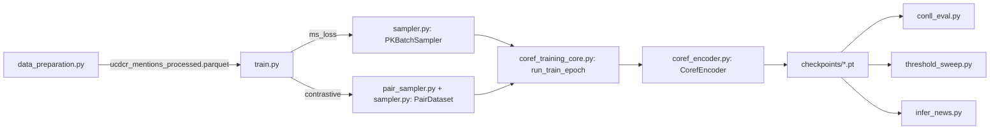

# ms-coref

Cross-document coreference resolution (CDCR) via metric learning: a shared
RoBERTa-large mention encoder trained to place coreferent mentions close
together in embedding space, evaluated by agglomerative clustering + the
standard CDCR metric suite (MUC, B³, CEAFe, LEA, pd_LEA).

The package supports **two pluggable training regimes** that share the same
encoder architecture and evaluation protocol, differing only in loss function
and how training batches are constructed:

| Regime | Loss | Batch construction | Origin |
|---|---|---|---|
| `ms_loss` (default) | `MultiSimilarityLoss` | Dynamic **PK batch sampler** — chain-labeled batches, PD/difficulty-weighted | ms-coref |
| `contrastive` | `ContrastiveLoss` (margin-based) | Static **SBERT MST + KNN pair sampler** — precomputed hard positive/negative pairs | ported from `cl-coref-orig` |

Both regimes train the exact same `CorefEncoder` (RoBERTa-large + dual MLP
projection heads), since it is architecturally identical to
`cl-coref-orig`'s `SiameseNetwork` and both losses operate on cosine
similarity of the resulting embeddings.

## Data

Trains on the **uCDCR** benchmark (`AnZhu/uCDCR` on the HuggingFace Hub), a
unified collection of 12 cross-document coreference datasets (CD2CR, CEREC,
ECBplus, ECBplusMETAm, FCC, GVC, HyperCoref, MEANTIME, NIdent, NP4E,
NewsWCL50, WECEng). By default, training/evaluation uses a 6-dataset subset
(`HyperCoref, NP4E, NewsWCL50, NIdent, ECBplus, ECBplusMETAm`, configured via
`DATASETS` in [train.py](train.py)).

## Pipeline



1. **[data_preparation.py](data_preparation.py)** downloads all uCDCR datasets,
   builds `mention_sentence_context` (mention sentence with `[E]`/`[/E]`
   markers) and `document_context` (surrounding sentences), computes phrasing
   diversity (PD) components, and writes
   `data/ucdcr_mentions_processed.parquet` (+ a chain-level summary table).
2. **[train.py](train.py)** loads that parquet, builds the model/data/loss for
   the selected `--loss-type`, trains for N epochs with periodic per-subtopic
   validation across all evaluation datasets, and checkpoints the best model.
   After training, it shells out to `conll_eval.py` on the test split.
3. **[conll_eval.py](conll_eval.py)**, **[threshold_sweep.py](threshold_sweep.py)**,
   **[infer_news.py](infer_news.py)** run further evaluation/analysis from a
   saved checkpoint (see below).

## Module reference

### Shared (used by every training regime)

- **[metrics.py](metrics.py)** — coreference scoring primitives, fully
  model-agnostic: `f1`, `compute_muc`, `compute_b_cubed`, `compute_ceafe`,
  `compute_lea`. Pure functions over cluster-assignment sets; reused by both
  training regimes and by `conll_eval.py`.
- **[coref_encoder.py](coref_encoder.py)** — the shared architecture and
  evaluation layer:
  - `CorefEncoder`: RoBERTa-large + dual MLP heads (CLS projection + mention
    span projection), concatenated and L2-normalized into a 2048-dim
    embedding. Identical design to `cl-coref-orig`'s `SiameseNetwork`.
  - `compute_embeddings`: batch-encode a dataloader into `(N, D)` embeddings.
  - `compute_all_metrics`: cluster assignments + gold labels →
    MUC/B³/CEAFe/LEA/pd_LEA dict (built on `metrics.py`).
  - `evaluate_clustering` / `evaluate_per_subtopic`: agglomerative clustering
    (cosine distance) + `compute_all_metrics`, either over the whole dataset
    or independently per subtopic (the standard CDCR evaluation protocol).
- **[coref_utils.py](coref_utils.py)** — backward-compatible re-export shim
  for the above (kept so existing imports in `conll_eval.py`,
  `threshold_sweep.py`, `infer_news.py` keep working unchanged).
- **[sampler.py](sampler.py)** — dataset/tokenization utilities for both
  regimes:
  - `custom_tokenize_with_special_tokens`: truncates doc/mention context to
    `max_length` while always preserving the `[E]`/`[/E]` markers.
  - `MentionDataset` + `PKBatchSampler` + `ChainIndex` + `SingletonPool` +
    `build_dataloader`: the **`ms_loss` regime's** dynamic batch sampler (see
    below).
  - `PairDataset` + `pair_collate_fn`: the **`contrastive` regime's** static
    pair dataset, consuming pairs produced by `pair_sampler.py`.
- **[pair_sampler.py](pair_sampler.py)** — the **`contrastive` regime's**
  pair-sampling algorithm (ported from `cl-coref-orig`, Hsu & Horwood,
  NAACL 2022): builds a minimum spanning tree per coreference chain (using
  SBERT sentence-similarity as edge weight) to pick *hard* positive pairs,
  then mines the K hardest same-subtopic non-coreferent partners for each
  positive-pair mention as negatives. Entry point:
  `sample_pairs_from_mentions(mention_df, params)`.

### Training core — the pluggable piece

- **[coref_training_core.py](coref_training_core.py)** is where the two
  regimes diverge. This is the extension point for adding a third regime.
  - `MultiSimilarityLoss` — Wang et al. (CVPR 2019); online positive/negative
    mining within a batch. Used by `ms_loss`.
  - `ContrastiveLoss` — margin-based `label * d² + (1-label) * relu(margin - d)²`
    on cosine distance `d`. Ported from `cl-coref-orig`'s
    `CustomContrastiveLoss`. Used by `contrastive`.
  - `GatherWithGrad` / `gather_embeddings` / `LabelEncoder` — cross-GPU
    embedding gathering and string→int chain-label encoding, needed only by
    the `ms_loss` regime (MS Loss mines pairs across the whole batch/across
    GPUs; contrastive pairs are already fixed per-sample).
  - `load_and_filter_mentions(...)` — shared data loading: reads the
    processed parquet, filters to the experiment's datasets, optionally drops
    HyperCoref sport topics, and builds the train-only mention table for the
    configured `TRAIN_MODE` (`single` / `hypercoref_main` / `mix`).
  - `build_model_and_data(training_mode, ...)` — builds the (always shared)
    `CorefEncoder` plus the dataloader and loss for `training_mode`:
    - `ms_loss`: `sampler.build_dataloader` (PK sampler) + `MultiSimilarityLoss`.
    - `contrastive`: `pair_sampler.sample_pairs_from_mentions` +
      `sampler.PairDataset` + `ContrastiveLoss`.
  - `run_train_epoch(training_mode, ...)` — runs one training epoch,
    branching to `_run_ms_loss_epoch` (memory-efficient 3-phase chunked
    forward/backward, since MS Loss needs the whole batch's embeddings for
    online mining but activations for the whole batch don't fit in memory) or
    `_run_contrastive_epoch` (ordinary forward/backward per pair batch, no
    chunking needed since there's no cross-sample mining).
- **[train.py](train.py)** — CLI entry point and orchestration only:
  argument parsing, DDP setup, calling `load_and_filter_mentions` /
  `build_model_and_data` / `run_train_epoch`, per-epoch validation
  (`evaluate_per_subtopic` across all configured datasets), checkpoint
  selection/saving, and kicking off `conll_eval.py` on the test split at the
  end.

### Evaluation / analysis (from a saved checkpoint)

- **[conll_eval.py](conll_eval.py)** — per-subtopic, per-entity-type
  (`entities` / `events` / `mix`) CoNLL file + metrics CSV export, for
  cross-checking against an external Perl scorer.
- **[threshold_sweep.py](threshold_sweep.py)** — sweeps the clustering cosine
  distance threshold (0.1–0.9) across all validation datasets and reports
  pd_LEA F1 per threshold.
- **[infer_news.py](infer_news.py)** — NewsWCL50-specific deep-dive: threshold
  sweep + error analysis (per-topic, per-mention-type, per-NER-type,
  split/merge chain errors, worst-fragmented chains).
- **[results_analysis.md](results_analysis.md)** — write-up of experimental
  runs and per-dataset results for the `ms_loss` regime.
- **[01_uCDCR_exploration.ipynb](01_uCDCR_exploration.ipynb)** — exploratory
  notebook over the raw uCDCR data.

## Usage

```bash
# 1. Build the processed parquet (once)
python data_preparation.py

# 2. Train with the default MS Loss + PK sampler regime
python train.py --loss-type ms_loss

# 2b. Or train with the contrastive loss + pair sampler regime
python train.py --loss-type contrastive --contrastive-margin 0.7

# 3. Evaluate a checkpoint
python conll_eval.py --checkpoint <run_dir>/checkpoints/best_model.pt --split test
python threshold_sweep.py --checkpoint <run_dir>/checkpoints/best_model.pt
python infer_news.py --checkpoint <run_dir>/checkpoints/best_model.pt
```

Key CLI flags (see `train.py --help` for the full list):

- `--loss-type {ms_loss,contrastive}` — selects the training regime (default: `ms_loss`).
- `--tau`, `--gamma`, `--singleton-frac`, `--difficulty-alpha` — PK sampler knobs (`ms_loss` only).
- `--ms-alpha`, `--ms-beta`, `--ms-lambda` — `MultiSimilarityLoss` hyperparameters (`ms_loss` only).
- `--contrastive-margin`, `--contrastive-sbert-model`, `--contrastive-k-negatives` — `contrastive` regime knobs.
- `--batch-size`, `--micro-batch-size`, `--num-epochs`, `--lr` — general training config.

`TRAIN_MODE` (`single` / `hypercoref_main` / `mix`), `DATASETS`, and
`HYPERCOREF_EXCLUDE_TOPICS` are configured as constants at the top of
`train.py` rather than CLI flags, since they define the experiment rather
than a single run's hyperparameters.

## Adding a third training regime

1. Add a loss class to `coref_training_core.py`.
2. Add a branch to `build_model_and_data()` that builds the appropriate
   dataloader (reuse `CorefEncoder` — do not add a new model class unless the
   architecture genuinely needs to change).
3. Add a `_run_<regime>_epoch` function and wire it into `run_train_epoch()`.
4. Add the new choice to `train.py`'s `--loss-type` argument.

Everything else (data loading, validation, checkpointing, `conll_eval.py`,
`threshold_sweep.py`) works unchanged, since they only depend on the shared
`CorefEncoder` + `coref_encoder.py` evaluation functions.
